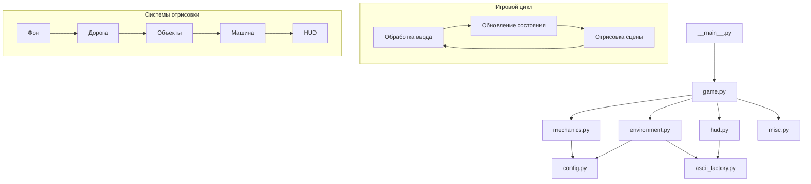
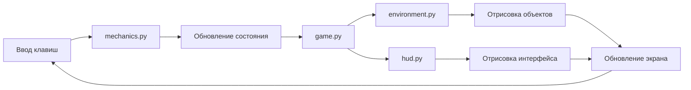
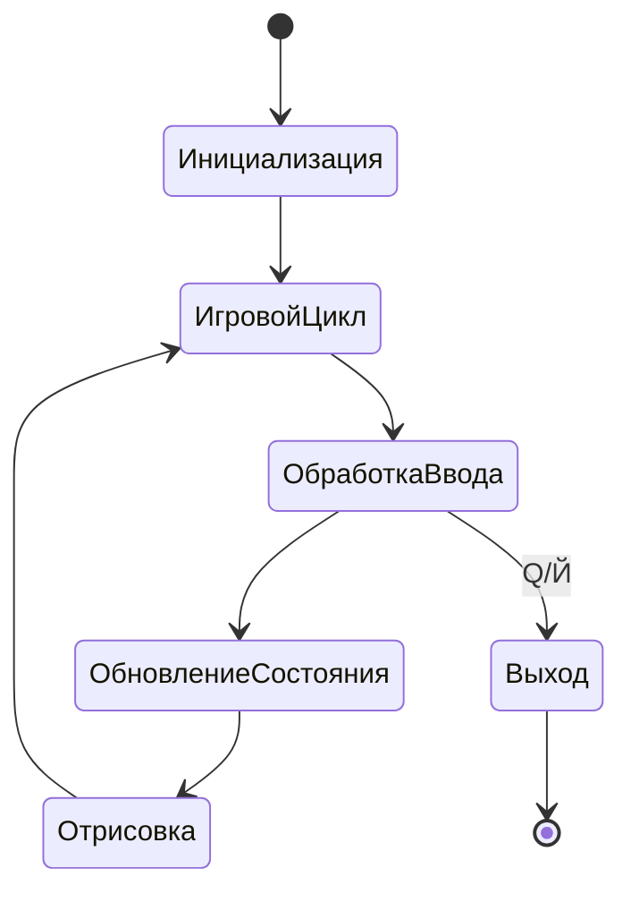

# ASCII Racer - Документация проекта

## Содержание
1. [Структура проекта](#структура-проекта)
2. [Описание файлов](#описание-файлов)
3. [Архитектура проекта](#архитектура-проекта)
4. [Библиотеки/фреймворки](#библиотекифреймворки)
5. [Точка входа и запуск](#точка-входа-и-запуск)
6. [Архитектурные особенности](#архитектурные-особенности)

---

## Структура проекта

### Дерево файлов и папок
```
├── asciiracer/
│   ├── __init__.py          # Пустой файл инициализации пакета
│   ├── __main__.py          # Точка входа в приложение
│   ├── ascii_factory.py     # Генерация ASCII-графики для чисел
│   ├── config.py            # Конфигурационные параметры игры
│   ├── environment.py       # Отрисовка игрового окружения
│   ├── game.py              # Основная игровая логика
│   ├── hud.py               # Интерфейс пользователя (HUD)
│   ├── mechanics.py         # Игровая механика и управление
│   └── misc.py              # Вспомогательные функции
└── README.md                # Документация проекта
```

---

## Описание файлов

### `asciiracer/__main__.py`
**Назначение:** Точка входа в приложение
**Ключевые функции:**
- `main()` - инициализирует и запускает игру

**Связи:** Импортирует `game.run()`
**Логика:** Простой файл-точка входа, который запускает основной игровой цикл

### `asciiracer/game.py`
**Назначение:** Основная игровая логика и управление
**Ключевые функции:**
- `main(screen)` - основной игровой цикл
- `draw_scene(screen)` - отрисовка всех элементов игры
- `run()` - обертка для curses

**Связи:** Импортирует все модули отрисовки и механики
**Логика:** Управляет игровым циклом, обработкой клавиш и координацией всех систем

### `asciiracer/mechanics.py`
**Назначение:** Игровая механика и управление
**Ключевые функции:**
- `update_state(key, state)` - обработка ввода и обновление состояния
- `update_steering(state, steer_tuple)` - управление рулением
- `update_speed(state, speed_tuple)` - управление скоростью
- `collect_money(state)` - сбор бонусов

**Связи:** Использует конфигурацию из `config.py`
**Логика:** Обрабатывает клавиши WASD (и русские аналоги), управляет движением машины и сбором предметов

### `asciiracer/environment.py`
**Назначение:** Отрисовка игрового окружения
**Ключевые функции:**
- `init(screen)` - инициализация окружения
- `draw_tracks(screen, state)` - отрисовка дорожных полос
- `draw_car(screen, state)` - отрисовка машины игрока
- `draw_debris(screen, state)` - отрисовка препятствий
- `draw_money(screen, state)` - отрисовка бонусов
- `spawn_sprite()` - создание игровых объектов

**Связи:** Использует `Sprite` для объектов, конфигурацию из `config.py`
**Логика:** Управляет всеми визуальными элементами игры, включая параллакс-эффекты

### `asciiracer/hud.py`
**Назначение:** Интерфейс пользователя (HUD)
**Ключевые функции:**
- `init(screen)` - инициализация HUD
- `draw_hud(screen, state)` - отрисовка интерфейса
- `draw_speedmeter(screen, state)` - спидометр

**Связи:** Использует `ascii_factory.num2str()` для отображения чисел
**Логика:** Отображает игровую информацию (скорость, время, счет)

### `asciiracer/ascii_factory.py`
**Назначение:** Генерация ASCII-графики
**Ключевые функции:**
- `num2str(num)` - конвертация чисел в ASCII-графику

**Связи:** Используется в `hud.py` для отображения спидометра
**Логика:** Содержит шаблоны ASCII-цифр и конвертирует числа в строковое представление

### `asciiracer/config.py`
**Назначение:** Конфигурационные параметры
**Ключевые параметры:**
- `GAME_SIZE` - размер игрового поля
- `FPS` - частота кадров
- `BASE_SPEED`, `MAX_SPEED` - параметры скорости
- `STEERING_STEP` - шаг руления
- `HORIZON`, `TRACK_SLOPE` - параметры дороги

**Связи:** Используется во всех модулях
**Логика:** Централизованное хранение всех настроек игры

### `asciiracer/misc.py`
**Назначение:** Вспомогательные функции
**Ключевые функции:**
- `limit_fps(fps)` - ограничение FPS
- `linear_interpolate()` - линейная интерполяция
- `make_in_range()` - ограничение значений
- `rectangle_overlap()` - проверка пересечения прямоугольников
- `get_terminal_size()` - получение размера терминала

**Связи:** Используется в `game.py` и `environment.py`
**Логика:** Утилитарные функции для математических операций и системных вызовов

---

## Архитектура проекта

### Общая структура

ASCII Racer использует модульную архитектуру с четким разделением ответственности:



### Потоки данных



### Система состояний



---

## Библиотеки/фреймворки

### curses
**Назначение:** Управление терминальным интерфейсом
**Где используется:** `game.py`, `environment.py`, `hud.py`
**Функции:** Отрисовка в терминале, обработка клавиш, управление экраном

### windows-curses (для Windows)
**Назначение:** Совместимость curses с Windows
**Где используется:** Автоматически при установке на Windows
**Функции:** Обеспечивает работу curses в Windows-терминале

### Стандартные библиотеки Python
- `random` - генерация случайных чисел для объектов
- `collections.namedtuple` - структуры данных для спрайтов
- `time` - управление временем и FPS
- `os`, `sys` - системные вызовы
- `ctypes` (Windows) - получение размера консоли

---

## Точка входа и запуск

### Как запускается проект

1. **Точка входа:** `asciiracer/__main__.py`
2. **Инициализация:** `game.run()` → `curses.wrapper(main)`
3. **Настройка экрана:** `screen.resize()`, `screen.nodelay(True)`
4. **Инициализация модулей:** `environment.init()`, `hud.init()`
5. **Игровой цикл:** Бесконечный цикл обработки ввода и отрисовки

### Что выполняется первым

```python
# 1. Импорт модулей
from . import game

# 2. Запуск игры
def main():
    game.run()

# 3. Инициализация curses
def run():
    curses.wrapper(main)

# 4. Настройка экрана
def main(screen):
    screen.resize(*GAME_SIZE)
    screen.nodelay(True)
```

### Команды запуска

```bash
# Установка зависимостей
pip install windows-curses  # для Windows

# Запуск игры
python -m asciiracer
```

---

## Архитектурные особенности

### Нестандартные решения

1. **Система спрайтов с параллаксом**
   - Объекты движутся с разной скоростью для создания эффекта глубины
   - Использование `Sprite` namedtuple для унификации объектов

2. **Модульная система отрисовки**
   - Список функций отрисовки `SCENE` позволяет легко изменять порядок слоев
   - Каждый модуль отвечает за свой слой отрисовки

3. **Поддержка мультиязычности**
   - Обработка как английской (WASD), так и русской (ЦФЫВ) раскладки
   - Единая логика обработки клавиш

4. **Адаптивный размер терминала**
   - Автоматическое определение размера консоли
   - Различные реализации для Windows и Unix-систем

### Причины выбора архитектуры

1. **Модульность:** Легкое добавление новых функций и модификация существующих
2. **Производительность:** Минимальные накладные расходы, прямая работа с терминалом
3. **Кроссплатформенность:** Работает на Windows, Linux, macOS
4. **Простота:** Минимальные зависимости, только стандартные библиотеки Python

### Паттерны проектирования

1. **Observer Pattern:** Система событий через обработку клавиш
2. **Factory Pattern:** `ascii_factory.py` для создания ASCII-графики
3. **State Pattern:** Централизованное управление состоянием игры
4. **Decorator Pattern:** `@limit_fps` для контроля производительности

### Управление

| Действие | Английская раскладка | Русская раскладка |
|----------|---------------------|-------------------|
| Ускорение | W | Ц |
| Торможение | S | Ы |
| Влево | A | Ф |
| Вправо | D | В |
| Выход | Q | Й |
| Пауза | P | З |

---

---

Автор: legenda  
Telegram: [@LEGENDA_SD](https://t.me/LEGENDA_SD)
